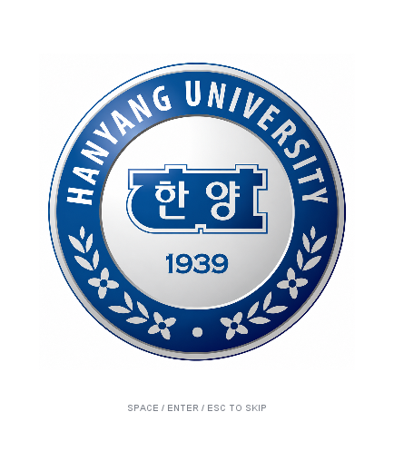
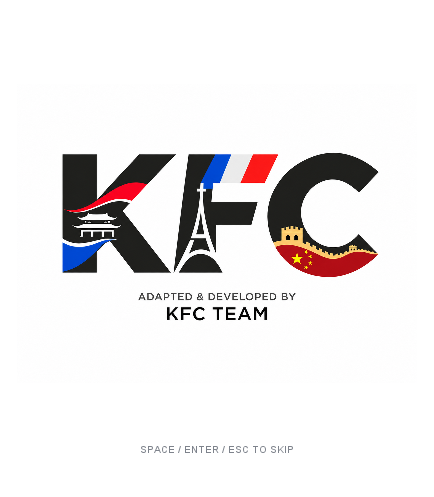
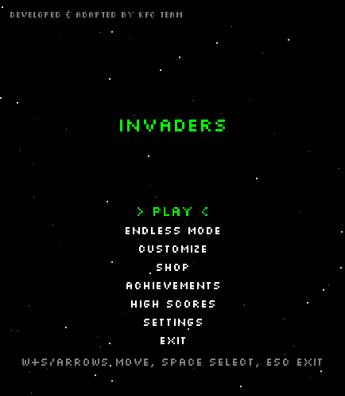

# Startup animation and team credit

The game opens with the supplied Hanyang University emblem, followed by the KFC
team credit image, then the existing title screen. Each image has a 3.2-second
scene with a gentle reveal, scale and fade. Images retain their full content and
aspect ratio. They load from `res/branding`, including when packaged inside a JAR.

Space, Enter or Escape skips either scene. Returning from gameplay does not replay
the opening. The original title-screen input handling prevents a held skip key
from immediately choosing Play or opening the exit confirmation.

The title screen also displays `DEVELOPED & ADAPTED BY KFC TEAM` at its upper-left
safe margin. It uses the existing pixel font and `Color.GRAY` (`#808080`), matching
the bottom key hints. Menu positions, unlock rules and combat HUD are unchanged.

`Core` invokes the opening once before its existing menu loop. `DrawManager`
caches the two logo images and draws the opening and menu credit. `TitleScreen`
only adds the credit draw call. `GameScreen` and the Endless implementation are
unchanged. Use `-Dgame.skipIntro=true` when a development run should skip it.

## Check the feature

Build and launch `engine.Core` with `res` on the classpath, as in the main README.
Confirm school-first ordering, full-image scaling, automatic return to the menu,
all three skip keys and the gray credit. Try the ordinary menu and Endless entry.

Run the deterministic startup checks with JDK 17+ (PowerShell):

```powershell
$check = Join-Path $PWD 'bin/startup-check'
New-Item -ItemType Directory -Force "$check/classes", "$check/previews" | Out-Null
$sources = @(Get-ChildItem src -Recurse -Filter *.java) + @(Get-ChildItem tests/startup -Filter *.java)
javac --release 17 -encoding UTF-8 -d "$check/classes" $sources.FullName
java '-Djava.awt.headless=true' -cp "$check/classes;res" screen.StartupAnimationTest "$check/previews"
```

The 41 checks cover resource loading, scene order and transitions, duration,
viewport sizing, missing-image fallbacks, all skip keys and held-key menu safety.
Test saves and generated previews stay under the ignored `bin/startup-check`.




